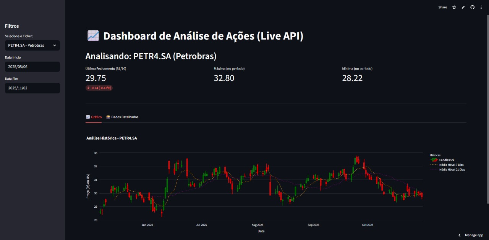

# 📈 Dashboard de Análise Quantitativa de Ações

> Pipeline ETL automatizado + Dashboard interativo para análise técnica de ações em tempo real.

### 🔴 Live Demo
**[https://stockdatapipeline-jnuaqfhrnt8jts3ymssrsp.streamlit.app/](https://stockdatapipeline-jnuaqfhrnt8jts3ymssrsp.streamlit.app/)**



---

## ⚡ Performance

| Métrica | Resultado |
|---|---|
| Download + processamento de dados | **0,81 segundos** |
| Velocidade de cálculo (CPU) | **76.472 registros/segundo** |
| Tempo de cálculo dos indicadores | **0,0033 segundos** |
| Cache inteligente (TTL) | **3.600 segundos** |

---

## 🛠️ Stack


---

## 📋 Sobre o Projeto

Dashboard de análise técnica de ações construído com Streamlit e hospedado na Streamlit Community Cloud. Busca dados ao vivo via API do Yahoo Finance (`yfinance`), calcula indicadores técnicos em tempo real com NumPy/Pandas e exibe visualizações interativas com Plotly.

---

## ✨ Funcionalidades

- **Filtros dinâmicos** por ticker (PETR4, VALE3, AAPL, NVDA e outros) e período personalizado
- **Gráfico de Candlestick** interativo com Plotly (abertura, máxima, mínima, fechamento)
- **Indicadores técnicos calculados em tempo real:**
  - Médias Móveis Simples (SMA 20 e SMA 50)
  - Bandas de Bollinger (±2 desvios padrão, janela 20)
  - RSI — Índice de Força Relativa (janela 14)
  - Volatilidade Anual (janela 21, anualizada por √252)
  - Retorno Diário percentual
- **KPIs em destaque:** preço atual, variação %, RSI, volatilidade e tendência vs SMA 20
- **Cache inteligente** com `@st.cache_data` — chamadas repetidas não rebatem a API
- **Aba de dados brutos** com tabela completa ordenável

---

## 🏗️ Arquitetura

```
yfinance API (ao vivo)
       │
       ▼
  @st.cache_data (TTL 3600s)
       │
       ▼
  Transformação com Pandas
  (normalização, renomeação, datas)
       │
       ▼
  Cálculo de Indicadores (NumPy/Pandas)
  SMA · Bollinger · RSI · Volatilidade
       │
       ▼
  Visualização Plotly → Streamlit Cloud
```

---

## 🚀 Executar Localmente

```bash
# Clone o repositório
git clone https://github.com/Daviramos7/stock_data_pipeline
cd stock_data_pipeline

# Crie e ative o ambiente virtual
python -m venv venv
.\venv\Scripts\activate  # Windows
source venv/bin/activate  # Linux/Mac

# Instale as dependências
pip install -r requirements.txt

# Execute o dashboard
streamlit run dashboard.py
```

---

## 📄 Licença

Copyright © 2026 por Davi Ramos Ferreira. Todos os Direitos Reservados.

---

**Desenvolvido com 💙 por [Davi Ramos Ferreira](https://github.com/Daviramos7)**
