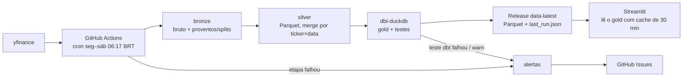
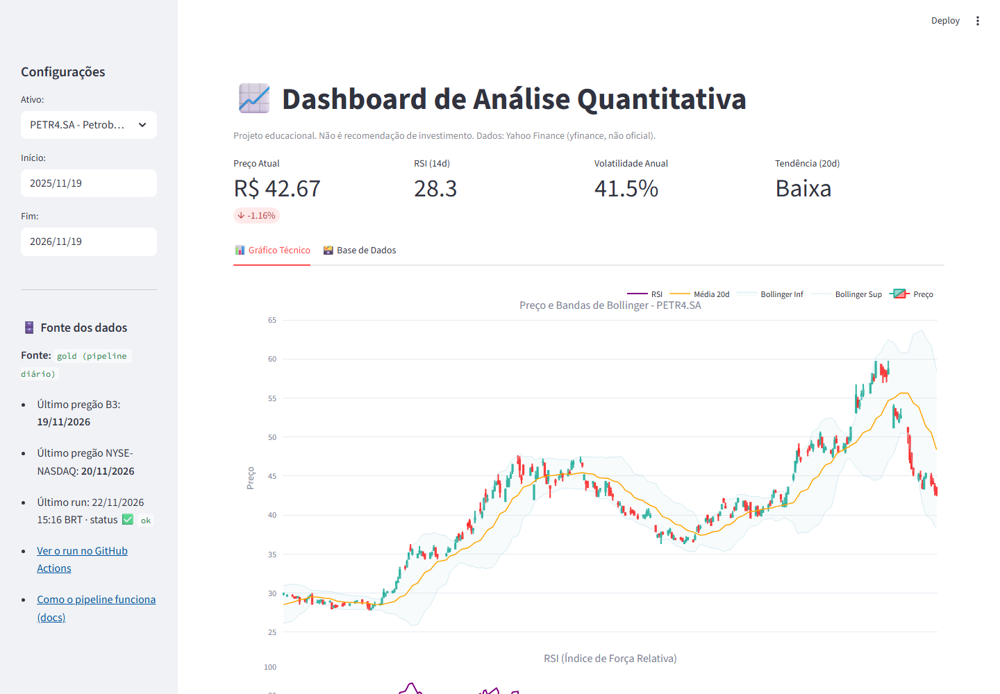
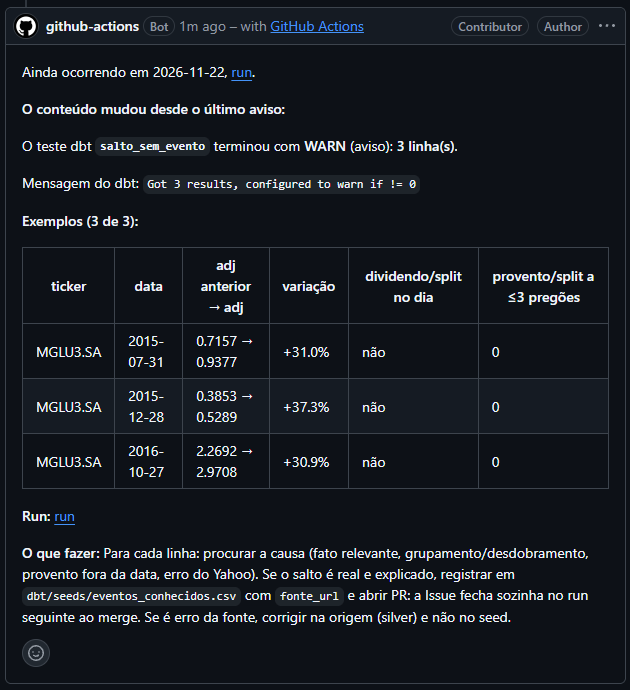

# 📈 stock_data_pipeline

Pipeline diário de cotações da B3 e dos EUA com camadas bronze/silver/gold, dbt, orquestração no GitHub Actions e alertas por Issue; o dashboard em Streamlit lê do gold.

[](https://github.com/Daviramos7/stock_data_pipeline/actions/workflows/ci.yml)
[](https://github.com/Daviramos7/stock_data_pipeline/actions/workflows/pipeline.yml)

**App:** [https://stockdatapipeline.streamlit.app/](https://stockdatapipeline.streamlit.app/) · último run: [`status/last_run.json`](status/last_run.json)

> ⚠️ **Projeto educacional. Não é recomendação de investimento.** Dados do Yahoo Finance via `yfinance` (não oficial).

## Como funciona



Se o gold estiver inacessível, o app avisa e cai para o modo antigo (yfinance ao vivo), sem sair do ar.

## Prints

| Dashboard lendo do gold (PETR4) | Alerta automático (Issue) |
| --- | --- |
|  |  |

## Números medidos

Cada número tem origem e data; nada aqui é estimado.

| O quê | Valor | Origem (data) |
| --- | ---: | --- |
| Linhas no silver | 29 708 | [`status/last_run.json`](status/last_run.json) (run de 22/11/2026) |
| Linhas em `fato_cotacao_diaria` | 29 654 | idem |
| Tickers | 10 (6 B3 + 4 EUA), desde 2015-01-02 | idem; [ADR-001](docs/adr/ADR-001-stack.md) |
| Tempo do pipeline no runner (ingestão + dbt + export) | 8,67 s (2,12 + 6,48 + 0,07) | `duracao_s` em [`status/last_run.json`](status/last_run.json) (22/11/2026) |
| `dbt build` | 44 PASS, 1 WARN, 0 ERROR | idem |
| Testes Python (`pytest -q`) | 111 passando | rodado localmente em 22/11/2026 |
| Abrir o app, cache vazio (mediana de 5) | 1,62 s (antigo: 0,74 s) | [`docs/fase7/medicoes.md`](docs/fase7/medicoes.md) (22/11/2026) |
| Abrir o app, gold em cache (mediana de 5) | 0,04 s | idem |
| Gold baixado pelo app (`fato_cotacao_diaria.parquet`) | 2,8 MB | idem |
| KPIs do último pregão, app novo × antigo | preço e SMA20 iguais; RSI difere ~1e-7 | idem; [`docs/fase4/comparacao_app_gold.md`](docs/fase4/comparacao_app_gold.md) |

O app novo é mais lento no primeiro acesso (baixa o histórico inteiro) e muito mais rápido depois; a explicação está em [`docs/fase7/medicoes.md`](docs/fase7/medicoes.md).

## Decisões e histórias técnicas

- **GitHub Actions × Airflow**: 1 execução por dia não justifica um host 24/7; cron + `workflow_dispatch` para backfill. [ADR-001](docs/adr/ADR-001-stack.md), [orquestração](docs/fase5/orquestracao.md)
- **Estado na Release**: bronze, silver e gold vivem como assets da Release `data-latest`, trocados com upload `.novo` e só então renomeados; o `last_run.json` é commitado como prova do run. [orquestração](docs/fase5/orquestracao.md)
- **Bronze bruto + ajuste depois**: o bronze guarda preço sem ajuste, proventos e splits; o ajustado é calculado no silver/gold e provento novo rebaixa o histórico do ticker. [ADR-001](docs/adr/ADR-001-stack.md)
- **Yahoo × calendário**: 54 linhas-fantasma da B3 (feriados de 2017/2018 com volume 0) descartadas por seed, e 20/11/2020, que teve pregão mas o Yahoo não tem. [calendário](docs/fase4/calendario.md)
- **RSI de Wilder e ddof do Bollinger**: o RSI passou de média simples para Wilder (alpha = 1/14); o Bollinger usa desvio amostral (ddof=1) de propósito, conferido contra a lib `ta`. [CHANGELOG](CHANGELOG.md), [`tests/test_indicadores_referencia.py`](tests/test_indicadores_referencia.py)
- **Alerta real**: a Issue #8 apontou 8 saltos de preço; a triagem com fonte confirmou 5 como eventos reais (viraram seed) e sobraram 3 sem fonte. [alertas](docs/fase6/alertas.md), [`eventos_conhecidos.csv`](dbt/seeds/eventos_conhecidos.csv)

## Como rodar local

App (o mesmo `requirements.txt` do Streamlit Cloud):

```bash
pip install -r requirements.txt
streamlit run dashboard.py
# opcional: ler outro gold (URL ou pasta local)
GOLD_BASE_URL=data/gold streamlit run dashboard.py
```

Pipeline e dbt:

```bash
pip install -r requirements-pipeline.txt -r requirements-dev.txt
pip install -e .
python -m stock_pipeline.pipeline.cli --data-dir data orquestrar --modo diario
python -m pytest -q
```

Para rodar o dbt sem rede, sobre um silver sintético, siga o job `dbt` de [`.github/workflows/ci.yml`](.github/workflows/ci.yml) (`scripts/gerar_silver_amostra.py` → `dbt build` → `scripts/exportar_gold.py`).

## Estrutura do repo

```
dashboard.py              app Streamlit (lê o gold; fallback yfinance)
src/stock_pipeline/       indicadores, gráficos, leitura do gold
src/stock_pipeline/pipeline/  bronze, silver, orquestração, alertas
dbt/                      modelos staging → intermediate → gold, seeds e testes
scripts/                  export do gold, alertas, amostra sintética
tests/                    pytest (inclui o app via streamlit AppTest)
docs/                     ADR e medições de cada fase
status/last_run.json      resultado do último run (commitado pelo bot)
```

## Limitações

- `yfinance` não é API oficial: pode mudar ou falhar sem aviso (se uma etapa do pipeline cair, ele abre Issue).
- Dados até o último pregão fechado; não é tempo real nem intraday.
- O horário do cron do GitHub não é garantido: o run pode atrasar.

## Licença

Copyright © 2026 por Davi Ramos Ferreira. Todos os direitos reservados.
